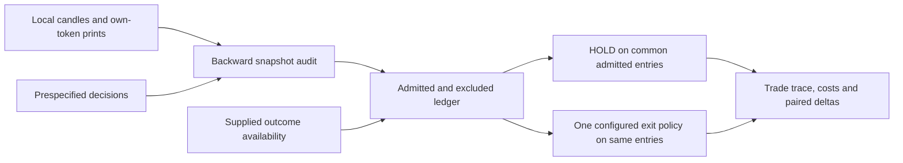

# Compare a fixed exit policy with holding the same entries

Use this offline tool when you have saved observations and an externally defined
entry rule, and want to inspect how exits and modeled costs change each trade.
`scripts/replay_events.py` calls the actual snapshot audit and exit simulator. It
reports admitted and excluded decisions, matched trade traces and cash accounting.
It does not download data, fit a model, search policies or select a winner.

## Run it

Python3.11 is the locally tested version. Use the committed lockfile and development
extra for reproducible dependencies; no credential or service is needed for replay.

```bash
uv sync --extra dev --frozen
uv run python scripts/replay_events.py \
  --candles examples/event_replay/candles.csv \
  --decisions examples/event_replay/decisions.csv \
  --prices examples/event_replay/prices.csv \
  --outcomes examples/event_replay/outcomes.csv \
  --evaluated-at 2026-01-01T12:21:00Z
```

The original [synthetic example](../examples/event_replay/README.md) includes a
take-profit, a stop-loss, a missing-path settlement and a missing-entry exclusion.
The computed summary is three admitted entries, one excluded entry and six paired
trade rows. The example intentionally contains a trade that exits worse than holding.
Its cash values are fixture arithmetic, not evidence of profitable trading.

JSON goes to stdout. `--out new-report.json` also creates a new file in an existing
directory. An existing output, output equal to an input, missing file or invalid
input exits2. Input validation completes before output creation. An eligible-row
count of zero is a valid report with empty trades and two empty strategy summaries.
Fix invalid inputs or choose a new output path and rerun; the tool never edits inputs.

## Input and clock contracts

| File | Required columns | Meaning |
|---|---|---|
| candles | ts, close, timestamp_semantics | ts is declared close availability. The loader also accepts the existing legacy schema and migrates open timestamps; see SNAPSHOT_AUDIT.md. |
| decisions | decision_id, condition_id, side, start_dt, end_dt, snapshot_dt, up_asset_id, down_asset_id | One prespecified entry per market; unique nonempty IDs, side UP/DOWN, distinct own-token IDs, start_dt <= snapshot_dt < end_dt. |
| prices | condition_id, asset_id, ts, p | Historical own-token observations. Valid timestamps and finite p in[0,1]. Entry requires0<p<1. |
| outcomes | condition_id, realized_direction, outcome_available_at | One explicit UP/DOWN label per market. Its availability cannot precede end_dt. |

Supply UTC-offset ISO8601 timestamps. Both the library and CLI refuse naive clocks
instead of guessing a timezone; explicit local offsets are normalized to UTC.
The strict `load_replay_candles` helper validates every supplied candle time column
and refuses any row discarded by the legacy loader. The CLI uses this same helper
and captures each file once, then both
parses and SHA256-hashes those captured bytes. IDs are read as strings. The library
API `compare_replays` validates the frame it receives, with ts as declared
availability. It cannot reconstruct missing rows or original naive clocks already
erased by caller preprocessing. For saved candle CSVs, use strict preparation:

```python
from pathlib import Path
from polymarket_crypto_5min.event_replay import load_replay_candles

captured = Path("examples/event_replay/candles.csv").read_bytes()
candles = load_replay_candles(captured)
# Supply this frame to compare_replays together with your decision/price/outcome frames.
```

The existing `features.load_candles` helper retains its legacy coercion behavior;
it is not the strict preparation API. `load_replay_candles` also validates the
supplied close clock through that existing loader.
If close_ts exists, availability must be at least close_ts+1ms under this repo's
Binance convention. Declared timestamps do not prove vendor delivery latency.

Conflicting prices at the same condition/asset/timestamp are refused: there is no
sequence number to order them. Conflicting candle closes at one availability time
are also refused. Identical duplicates are coalesced. Invalid observations are
refused even if beyond the evaluation cutoff, so malformed input is not hidden by
filtering. The cutoff controls availability, not an instruction to ignore bad data.

## The replay and what its fields mean



The audit uses the latest already-available candle and selected-side token print
inside the market window. Defaults allow at most60seconds of age for each.
Missing DOWN prints are never synthesized from UP. Observation inputs after
evaluated_at are not available to any decision. The ledger preserves exclusions:
DECISION_AFTER_AS_OF, INPUT_TIME_BLOCKED, PRICE_OUTSIDE_ENTRY_MODEL,
OUTCOME_MISSING and OUTCOME_NOT_AVAILABLE_AS_OF.

Both policies use the same admitted entries, stake and entry coefficient. Outcomes
admit resolved markets for scoring; they do not choose the entry side or early exit.
This is a matched comparison conditional on usable resolved entries, not a complete
portfolio or evaluation of pending positions. Keep the exclusion ledger with any
comparison to avoid silently changing the sample.

After entry, observations are processed chronologically, strictly before end_dt.
The first price trigger fires. A configured timer can use only the first observation
at/after its deadline; it cannot execute using an earlier print. At a timer event,
timer reason takes priority over coincident price reasons. Otherwise stop-loss takes
priority, then target-price, then take-profit. Exact decimal thresholds are inclusive
without an epsilon. A timer strictly before close with no subsequent price records
MAX_HOLD_NO_PRICE and settles; a timer at/after close records HOLD_TO_SETTLEMENT.
An observation stamped exactly at end_dt cannot be an early exit.

| Trade field | Interpretation |
|---|---|
| entry_dt / entry_observation_at | Decision time and the prior observation modeled as its fill price. |
| exit_dt / end_dt | Observed early-exit time or supplied outcome-availability time; scheduled market end stays separate. |
| exit_reason / realized_settlement | Trigger or settlement fallback, and whether payout rather than an early sale is modeled. |
| path_points_seen / path_points_processed | All available post-entry/pre-close points versus points actually examined before exit. The first is a legacy count, not online knowledge at exit. |
| gross_pnl_usdc / modeled_fees_usdc / pnl_usdc | Gross change, explicit modeled fees and net cash result. |
| matched_deltas | CONFIGURED_EXIT minus HOLD for each common decision; no automatic strategy selection. |

## Cash model and assumptions

For entry price e, exit price x, stake S and declared coefficient r:

```text
entry fee per share = r * e * (1-e)
shares = S / (e + entry fee per share)
early-sale fee per share = exit_r * x * (1-x)
settlement fee in this model = 0
gross cash change = shares * (x-e)
net cash change = gross cash change - shares * (entry fee + exit fee)
```

Settlement price is1 for the supplied winning side and0 otherwise. Stake includes
the modeled entry fee; early-exit fees reduce sale proceeds. The CLI defaults to
coefficient0.07 for entry and early exit, with10 units of stake per independent
position. These are explicit inputs. The library accepts an ExitPolicy with a
different exit coefficient and reports it.

The [official fee documentation](https://docs.polymarket.com/trading/fees), checked
14October2026, specifies a share/price-dependent taker formula, per-market parameters
and five-decimal fee rounding. This engine uses unrounded fees and does not retrieve
market-specific parameters or rebates. Its HISTORICAL_PRINT_MODEL assumes execution
at the observation price, with slippage, depth and latency UNMODELED. It neither
establishes executable quotes nor verifies redemption timing; outcome_available_at
is supplied as the settlement-accounting clock. Overlapping positions have independent
stakes without a shared cash constraint.

## Evidence and reproducibility

```bash
uv run python scripts/evaluate_event_replay.py
uv run ruff check .
uv run ruff format --check .
uv run mypy polymarket_crypto_5min scripts tests
uv run pytest -q
```

The evaluation first compares the engine to an independent scalar Decimal oracle
over entry prices, sides, winning/losing labels, paths, costs and timer boundaries.
Reason and timestamp must match exactly; cash floats must agree within1e-12 with
zero relative tolerance. It then runs an unmodified copied control and source mutants
in disposable copies. Each mutation must fail its named witness: retrospective
timer fill, settlement print as exit, future-label admission, wrong entry fee,
wrong settlement clock, ignored price conflict, decimal boundary miss and timer
misclassification, ambiguous timezone admission and silently discarded candle rows.
Logs can be retained with `--out-dir new-directory`; actual
source files are never mutated. This is algorithm/contract evaluation, not model
accuracy or economic-performance evaluation.

Original regressions and the full quality workflow remain unchanged. Local passes
do not imply remote CI or release approval. The July results in docs/results.md
remain preserved, including the negative corrected result, trial exposure and missing
original inputs; they predate these fixes and are not revalidated by this fixture.
No full grid rerun was performed. See [verification scope](VERIFICATION.md) for
the accepted source, reproducible checks and remaining release limits.

This adds an original wrapper and fixtures around existing MIT-licensed repository
code, with the primary fee reference above. It contains no proprietary data, model,
lecture text or private upstream code. Repository LICENSE continues to apply.
